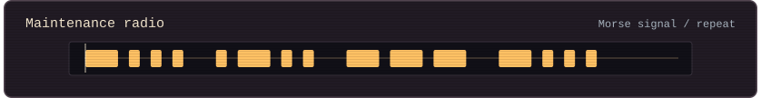

# Service hatch

Something’s transmitting on the maintenance channel.

Decode the signal

**BLOB.** Of course. [Send a snack](https://github.com/OminousOne/OminousOne/issues/new?title=feed&body=Press+Submit+to+feed+BLOB.).

[Back to the arcade](./README.md#arcade)
